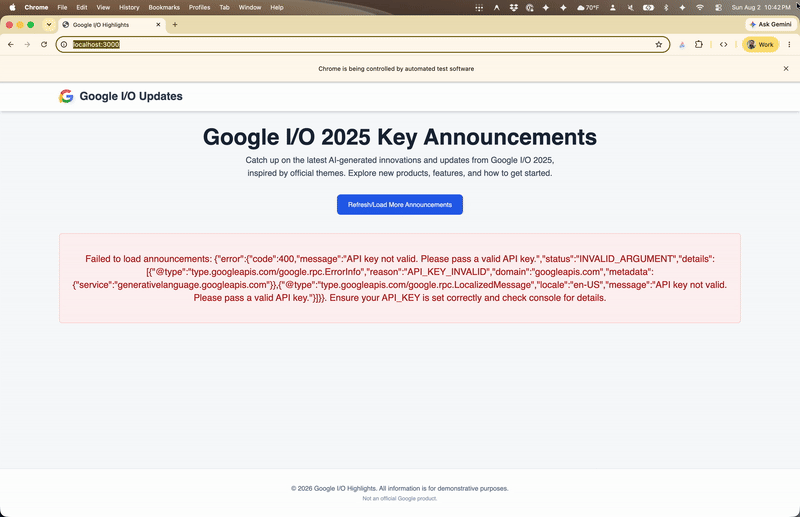
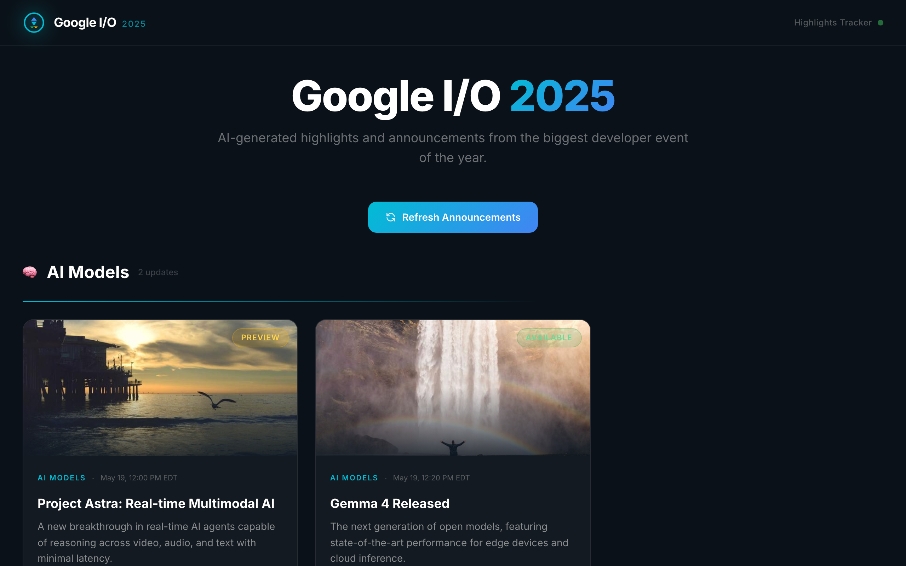
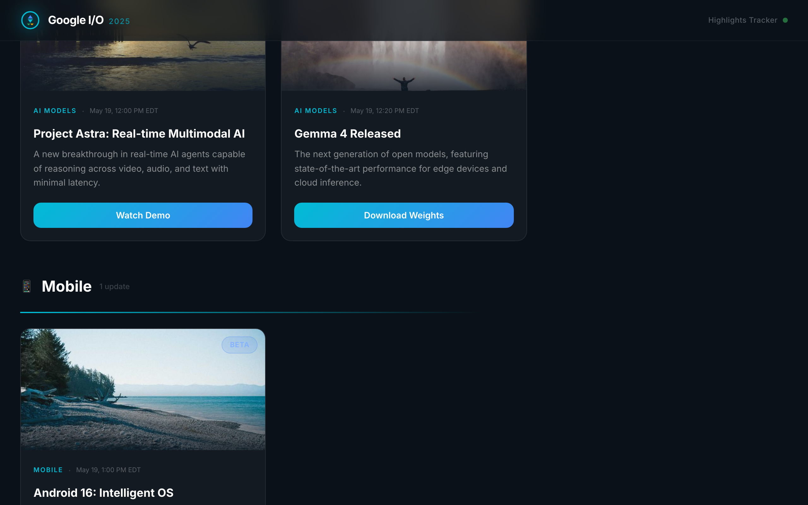

# Google I/O 2025 Highlights Tracker



A dark, glassmorphism-styled dashboard that pulls AI-generated announcements from Google I/O 2025. Categorized, timestamped, and searchable — built to look like the event page you wish existed.

## Quick Start

```bash
git clone <repo-url> && cd ais-google-i-o-highlights-tracker
npm install
cp .env.example .env.local  # Add your Gemini API key
npm run dev
```

*Requires Node.js 18+. Works without an API key too — falls back to sample data.*

## What It Does

Click **Refresh Announcements** to generate a batch of plausible I/O highlights via Gemini. Each announcement gets categorized, timestamped, and displayed in a card grid with status badges (Available, Beta, Preview, Waitlist). No API key? The app gracefully falls back to hardcoded demo data so you can still see the UI.





## Tech Stack

| Category | Technology |
|----------|------------|
| Framework | React 19 + Vite |
| Styling | Tailwind CSS 3 |
| Language | TypeScript |
| API | Google GenAI SDK (`gemini-2.5-flash`) |
| Design | Glassmorphism, dark theme, Inter font |
